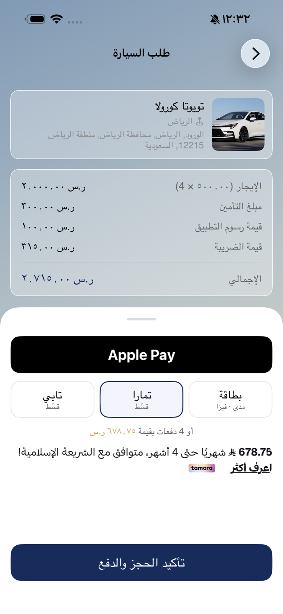
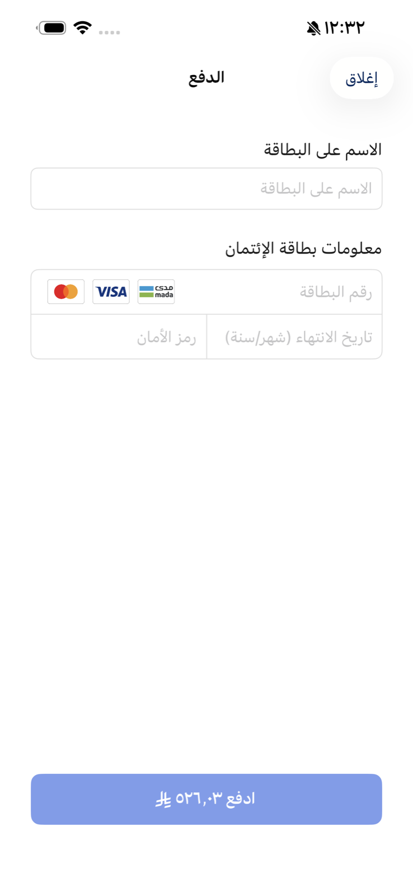
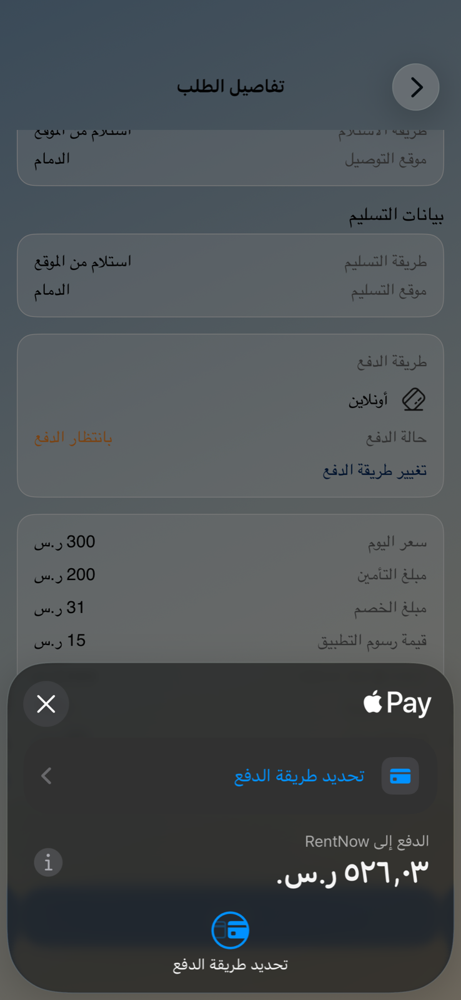

# RentNow iOS App

RentNow is an Arabic-first car rental marketplace for discovering vehicles, reviewing listing details, placing rental requests, and managing orders and subscription packages. The app is built for iPhone with SwiftUI and connects to the RentNow service backend.

## Features

- Browse vehicle listings and categories, including economy, compact, luxury, and camping vehicles.
- View vehicle photos, location, fuel type, description, ratings, and advertiser details.
- Choose rental dates and review the rental price, deposit, fees, tax, and total before booking.
- Manage orders, payment status, and delivery or pickup information.
- View wallet activity and available subscription packages.
- Use supported checkout flows, including card and Apple Pay options, with installment checkout integrations where available.
- Browse the app in Arabic with right-to-left layouts.

## App Screenshots

The supplied screenshots show Arabic app screens. The previews below are intentionally displayed at a smaller size; select an image to open it at full size.

<table>
  <tr>
    <td align="center"><a href="Screenshots/home-and-car-categories.png"></a><br><strong>Home and categories</strong><br>Location selection, featured cars, and rental categories.</td>
    <td align="center"><a href="Screenshots/car-details.png"></a><br><strong>Car details</strong><br>Photos, location, vehicle information, advertiser, and daily rate.</td>
    <td align="center"><a href="Screenshots/booking-cost-and-payment-options.png"></a><br><strong>Booking and payment options</strong><br>Rental cost breakdown and checkout choices, including installments.</td>
    <td align="center"><a href="Screenshots/card-payment-form.png"></a><br><strong>Card payment form</strong><br>Cardholder name, card number, expiry date, and security code fields.</td>
  </tr>
  <tr>
    <td align="center"><a href="Screenshots/order-payment-details.png"></a><br><strong>Order and payment details</strong><br>Pickup or delivery, payment status, and price summary.</td>
    <td align="center"><a href="Screenshots/subscription-plans.png"></a><br><strong>Subscription plans</strong><br>Compare package durations, discounts, and delivery benefits.</td>
    <td align="center"><a href="Screenshots/subscription-payment-method.png"></a><br><strong>Subscription payment</strong><br>Select Apple Pay or a bank card and review the package price.</td>
  </tr>
</table>

## Requirements

- macOS with Xcode that supports the project’s iOS deployment target (iOS 17.6).
- Swift 5 toolchain provided by Xcode.
- Xcode package resolution and network access for dependencies and backend services.
- Access to the RentNow backend and valid configuration for any third-party services used by your build.

## Getting Started

1. Clone or download this repository.
2. Open `RentNow.xcodeproj` in Xcode.
3. Select the `RentNow` scheme and an iOS simulator or connected iPhone.
4. Allow Xcode to resolve the Swift Package Manager dependencies.
5. Configure the required service credentials for your development environment, then build and run the app.

The app uses the RentNow backend configured in `RentNow/Networking/NetworkConstants.swift`. Review the project’s service configuration and use development credentials appropriate to your environment before running backend-dependent flows.

## Technology

- Swift and SwiftUI
- Swift Package Manager
- Alamofire for networking
- Google Maps SDK
- Firebase Core and Firebase Messaging
- Moyasar, Tabby, and Tamara payment integrations
- Kingfisher and Lottie

## Project Structure

```text
RentNow/
├── App/             # Screens and user flows: home, listings, orders, wallet, profile
├── Core/            # App entry point and app-level setup
├── Networking/      # API requests, responses, and network configuration
├── Resourses/       # App assets, fonts, and localized resources
└── Shared/          # Reusable UI, location, payment, and utility code
Tests/               # Payment contract tests
Vendor/              # Vendored payment SDK source
Screenshots/         # Screenshots shown in this README
```

## Tests

The repository includes payment contract tests in `Tests/`. To run them, use Xcode’s test action for the project or inspect `Tests/run-payment-contract-tests.sh` for the provided test runner and its prerequisites.

## Notes

- Keep API keys, signing materials, and payment credentials out of public commits. Use environment-specific configuration and restrict any client-side keys to the appropriate app identifiers and services.
- Payment availability and installment eligibility depend on backend configuration, provider approval, and the customer’s region and transaction.
